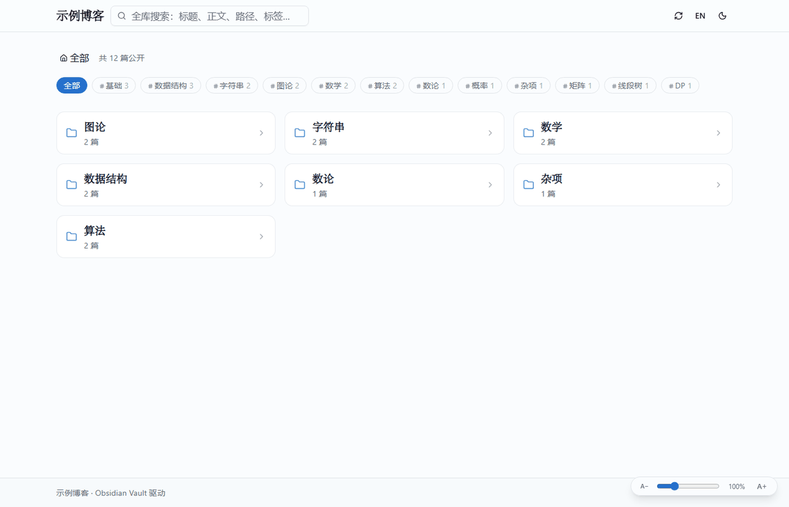
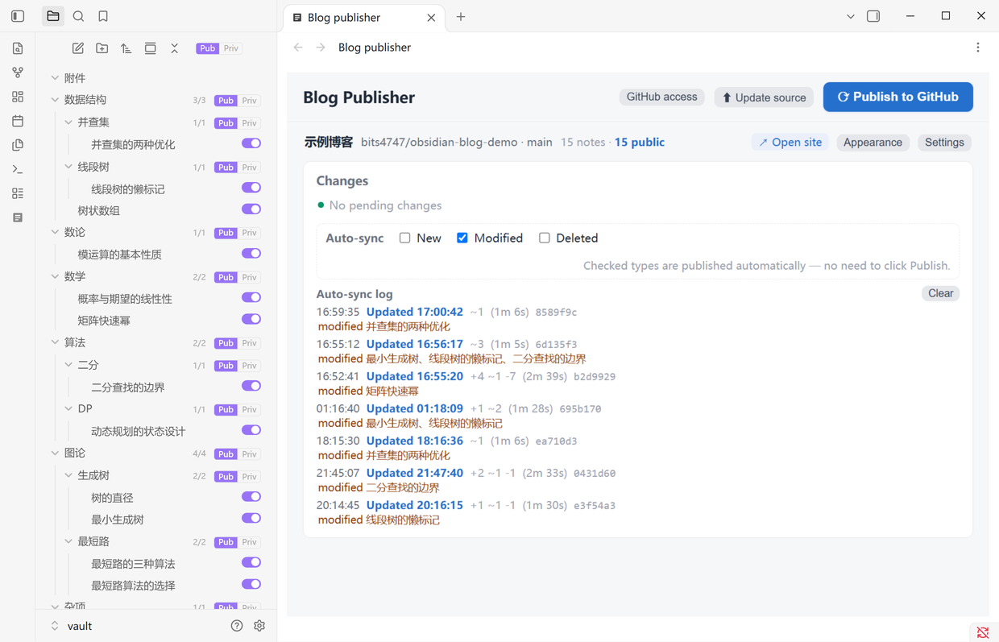
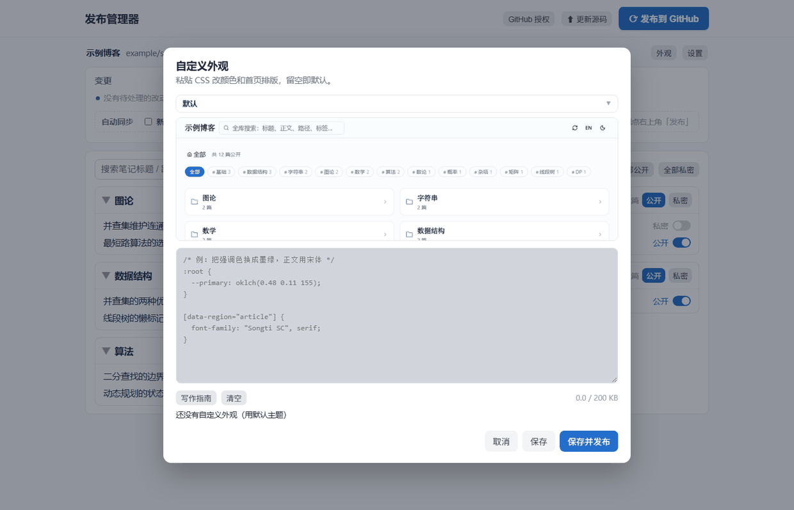
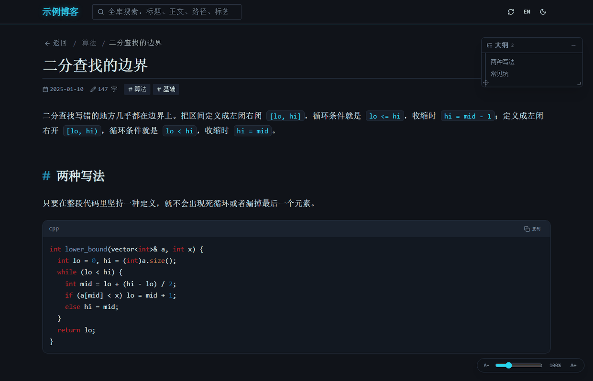

# Obsidian Blog

Publish your Obsidian notes as a static blog on GitHub Pages.

You don't need a second vault. Private and public notes live together — going public is just `public: true` in the frontmatter. Toggle notes one by one in the publisher, push once, and GitHub Actions builds and deploys the site.



## Highlights

- **One vault, public and private side by side** — only notes marked `public: true` are read and committed; private notes never enter the build
- **The toggle lives in the file explorer** — a small switch next to every note, plus "Publish all / Make all private" on each folder header. No separate web page needed
- **An Obsidian-like reading experience** — wikilinks, embeds, callouts, math, tags, block references, hover previews, a draggable outline
- **Custom appearance** — paste a snippet of CSS to change colors and home layout. Six built-in presets (seven including the default), each with a preview image. No code changes
- **Pure static** — no database, no accounts, no server. The build output drops onto any static host
- **Bilingual** — the interface follows Obsidian's language setting; the site can be switched at any time

## Installation

No need to clone the repo or build anything yourself. Download the three files from [Releases](https://github.com/bits4747/obsidian-blog-publisher/releases/latest):

| File | Purpose |
|---|---|
| `main.js` | The plugin itself |
| `worker.js` | Background core (publishing and syncing run in a child process, off Obsidian's main thread) |
| `manifest.json` | Plugin manifest |

Put them in your vault's plugin directory. The directory name must be exactly `blog-publisher`:

```
<your vault>/.obsidian/plugins/blog-publisher/
├── main.js
├── worker.js
└── manifest.json
```

Then enable "Blog Publisher" in Obsidian settings → Community plugins (turn off Safe mode first).

### Requirements

| Needed | Why |
|---|---|
| **Git** ([download](https://git-scm.com)) | Publishing and fetching go through it; the plugin does not bundle git |
| **Node.js** | The background core runs in a child process. It prefers Obsidian's bundled `utilityProcess`; if that's unavailable it falls back to the system `node`. If neither works you get "plugin installed, but clicking does nothing" |
| A GitHub account | The site is hosted on GitHub Pages |

If clicking does nothing after enabling, first check that `git --version` and `node -v` both print something in a terminal.

### Updating

Download the same three files again and overwrite them (restart Obsidian to apply). The plugin does not auto-update — it isn't on the community plugin registry.

## Getting started

### 1. Create a connection

Click "Settings" in the top right. The local vault defaults to the one you have open. Give the blog a name, choose "Create a repo for me", enter a repo name, and click "Create on GitHub".

If you already have a repo, switch to "I already have a repo" and paste the URL. You don't need to enable Pages manually — it's turned on automatically after the first successful publish, and an existing Pages site is never recreated.

The blog name doubles as the display name in the publisher, the page title, and the site name in the top-left corner.

### 2. Authorize

Click "GitHub access" and follow the dialog to create a **Personal access token (classic)** with these two scopes:

| Scope | Purpose |
|---|---|
| `repo` | Push content, create repositories |
| `workflow` | The first deploy pushes `.github/workflows/deploy.yml`; GitHub requires this scope for any push that touches a workflow file |

> `repo` alone is not enough — the push is rejected with `refusing to allow a Personal Access Token to create or update workflow`.

Set the expiration to "No expiration". An expired token makes publishing, repo creation, and automatic Pages setup all fail together, and the error message doesn't tell you it expired.

**How the token is stored**: in plain text in `local.json` on your machine (see "Where data lives" below). Not encrypted, not committed, never uploaded. Any program that can read your user directory can read it — on a shared computer, delete the token when you're done. To revoke access, delete the token in GitHub's Settings → Developer settings → Tokens.

### 3. Pick notes and publish

Turn on the switch for the notes you want public, then click "⟳ Publish to GitHub". Wait 1–2 minutes and visit `https://<your-username>.github.io/<repo-name>/`.

## The publisher

Click the icon in the left ribbon, or run "Open Blog Publisher" from the command palette, and a tab opens in the main area. The interface's language and light/dark theme follow Obsidian.



| Feature | Description |
|---|---|
| Single vault | One Obsidian vault maps to one blog. The top row shows vault name · repo · note count · open site · settings |
| Per-note toggle | One switch per note, written into the frontmatter. Confirms with "Set *title* to public" |
| Bulk actions | "Publish all / Make all private" on every folder header, plus global buttons at the top |
| Search and filter | Filter by title and path; narrow down first, then act in bulk |
| Collapse | Every folder collapses; "Expand all / Collapse all" for the whole tree |
| Three change columns | Added / modified / deleted are listed separately, and added notes can be made public right there. Only changes **you need to handle** appear — categories with auto-sync on are pushed by the background process and drop out of these columns; if the last auto-sync push failed, those categories come back |
| Auto-sync | One switch per change category. When on, that category publishes itself without pressing Publish. Default: modified on, added/deleted off. Fires about 2.5 seconds after a file changes, but **only while Obsidian is running** |
| Sync log | Below the auto-sync row, the last few background actions: when the push started, which files changed, whether it landed, when the site finished updating, and the gap between. Failed pushes, failed builds, and build timeouts each leave a record. Stored locally, survives restarts |
| Result card | Every publish / source update / appearance save pops a card in the top right, starting as a spinner and settling on ✓ or ✗ with an expandable log. **No close button and no auto-dismiss — click anywhere on the card to dismiss it** |
| Build diagnostics | After a push it checks the GitHub Actions run, not just the live output. Stuck or failed builds are reported as "build failed" or "build timed out", with a direct link to the Actions page |
| Deploy progress | After a manual publish it polls the live `data/index.json` and shows "GitHub is building… N seconds elapsed", turning into "Live (took N seconds)" with a link. After 4 minutes it points you to Actions |
| Custom appearance | The "Appearance" button opens the CSS editor with seven presets (default + six) and preview images, ready to fill in and edit. See the next section |

## Custom appearance

A site's **behavior** and its **appearance** are separate here: behavior comes from React components in the source, appearance is concentrated in two overridable places — CSS variables (colors, radius, fonts) and `data-region` selectors (home and list layout). So you can reskin the site without touching a line of code.

Click "Appearance" in the publisher's top right and pick a preset from the dropdown (hover for a description; the selected one shows a **preview image** below). It fills the editor, and you edit from there. Hand-written CSS can't be pre-rendered, so "Custom" shows no preview.



### Built-in presets

| Preset | Home layout | Palette |
|---|---|---|
| Default | Three-column cards | Blue on white |
| Ink green | Three-column paper cards | Warm paper with pine green, all serif |
| Sakura | Single-column large cards, centered enlarged titles | Very pale pink with rose |
| Mono | Single-column plain-text index | Pure white and black, no radius |
| Tree | File tree with vertical guide lines and corner connectors | Green-grey paper |
| Mosaic | Mixed-size blocks, first block takes the lead | Six-color cycle |
| Neon | Numbered index rows | Near-black with cyan/magenta outlines, monospace |

### Writing your own CSS

```css
/* Colors: override the variables on :root; dark mode lives under .dark */
:root {
  --primary: oklch(0.48 0.11 155);   /* accent: links, buttons */
  --background: oklch(0.99 0.004 250);
  --radius: 0.625rem;
}
.dark {
  --primary: oklch(0.72 0.155 252);
}

/* Home and list layout: these blocks expose data-region, so you can change column count, cards vs tree */
[data-region="folders"] { display: grid !important; grid-template-columns: repeat(3, minmax(0,1fr)); }  /* home folders */
[data-region="list"]    { }                      /* note list */
[data-region="tags"]    { }                      /* tag bar */
[data-region="article"] { }                      /* article typography */

/* Fonts */
body { font-family: "Songti SC", Georgia, serif; }
```

The "Writing guide" button next to it opens a dialog listing the overridable variables, `data-region` selectors, and how to write font sizes, with a one-click insert of the color/radius block.

Three things to remember:

- **Width is not the theme's business**: the top bar, article, footer, and home all read `--content-w` (default `78rem`), and no preset writes `max-width`. Change that one value to widen or narrow everything at once.
- **Font sizes must use `var(--fsu)`**: `--fsu` is "1rem that follows the reading size". The root font size is deliberately left alone (otherwise zooming would distort column widths and controls), so write `calc(1.1 * var(--fsu))` to follow the slider.
- **Empty means default**: saving an empty box deletes `theme.css` and restores the default theme.

Saving writes `public/theme.css` in the repo working copy but doesn't deploy. "Save and publish" commits and pushes only that one file, without dragging along notes you weren't ready to publish. The limit is 200 KB; comments only count as no custom appearance. Changes take effect in 1–2 minutes, and the URL carries a content hash to bypass GitHub Pages caching.

### Why CSS only, not a full page template

The site is a Next static export; the page structure is compiled into React. Letting users edit HTML would mean exposing a template engine, and the security and upgrade costs aren't something this project should take on. CSS is enough for colors, fonts, spacing, visibility, and position (flex/grid are both overridable), and a stylesheet can never be executed as HTML/JS — `theme.css` is loaded via a `<link>`, not an inline `<style>`, so even a `</style>` can't escape.

Compared to platforms that hand you a whole skin (HTML + CSS + JS): less freedom, but your skin won't break when the site upgrades, and no scripts can be injected. The trade-off is that you can't change DOM structure — adding a new section, for example.

## The blog

The reading experience aims to reproduce how Obsidian renders notes.



### Home

- Shows `N public` at the top
- **Drill-down with breadcrumbs**: the home lists only the current level's subfolders (cards) and its own notes. Click a folder to descend; the breadcrumb `All › Parent › Current` jumps back to any level. Folders nest arbitrarily deep
- The current level is deep-linked via `?folder=`, so refresh, share, and back/forward all return to the same level. Note pages remember where you came from, and "Back" returns to that level
- Tag bar filtering, showing `Tag filter: (N notes)`
- Search matches title, body, path, and tags, and stacks with tag filtering. Body matches include a context snippet; opening one scrolls to that line and highlights it
- Freshness: the index is fetched with a minute-level URL, so even if Pages caches the HTML for 10 minutes you see new content within one

### Note page

- `N words`, publish date, tags
- A draggable floating outline on the right, with the current section highlighted; drag it, resize it
- Font zoom 80%–160% (bottom-right slider): **text only** — column width, card sizes, and controls stay put
- One content width site-wide (`--content-w`, default `78rem`) shared by the top bar, article, footer, and home

### Supported Obsidian syntax

| Syntax | Result |
|---|---|
| `[[Note]]` | Clickable, with a hover preview popup |
| Outlinks / backlinks | Lists "Linked from" and "Links out" at the end of each note |
| Uncreated / private | Outlinks distinguish the two; links to private notes show a lock |
| `![[attachment]]` | Images and other attachments render inline |
| `[!note]` etc. | 13 callout types |
| `==highlight==` | Highlight |
| `#tag` | Clickable filter. Pure numbers (`#2427`, problem IDs) and 3–8 digit hex values (`#ff0000`, colors) are not tags; `#xxx` inside link text is not parsed either |
| `^block-ref` | Jumps to a specific paragraph, falling back to the whole note if the target is gone |
| `$math$` | Rendered with KaTeX — including math in the outline |

The site supports Chinese/English switching and light/dark themes, and remembers reading preferences (font size, collapsed folders, filters) locally.

## What the plugin does

- In the file explorer, every note gets a small switch (24×13) on the right. Clicking it flips the public state — it writes the `public` field in the frontmatter
- Every folder header shows `published/total` plus two buttons, "Publish" and "Make private". Two buttons rather than one switch, because a single switch has one direction and a partially public folder could only be inferred as "all public"
- The toolbar above the file tree has the same buttons for the whole vault, with a confirmation prompt
- Three states: all public, all private, and partially public (neither button lit, with a `3/6` count at the end of the row)
- The "Blog Publisher" tab in the main area is the full publishing interface, matching the previous section

**Worth knowing**

- On first enable the plugin lays down the site source template (42 files, about 408 KB) into `site-template/` in the data directory; "Update source" uses it to push site code
- The template carries a content fingerprint, so upgrading the plugin re-lays it automatically — no need to delete the directory
- The explorer switches only work when **the current vault is the one configured in the publisher**; otherwise you get a notice and they're disabled
- Interface language and theme follow Obsidian (Simplified and Traditional Chinese both count as Chinese; everything else is English)
- The public flag is written into each note's frontmatter, so it travels with the note to another vault or machine

## FAQ

**Published, but the site didn't change?**
GitHub Actions takes 1–2 minutes. The result card shows "GitHub is building… N seconds elapsed" and switches to "Live (took N seconds)". After 4 minutes it points you to the repo's Actions page.

**Publishing fails with a push error?**
Read the expanded log first. The most common cause is an expired token — publishing, repo creation, and automatic Pages setup all fail together, and the message doesn't say why. Generate a new token and paste it in.

**Are private notes read or uploaded?**
No. The build reads only notes with `public: true` and the attachments they reference. Private notes' bodies, titles, and paths never appear in the repo.

**Can I change the page structure, like adding a section?**
No. Appearance is CSS only (see "Why CSS only" above). Adding a section is a feature change and means editing the React source.

**Can I use my own domain?**
Set Custom domain in the GitHub repo's Settings → Pages and point your DNS at it. That's done on GitHub; the publisher isn't involved.

**"Failed to load plugin" when installing?**
Check that `main.js`, `worker.js`, and `manifest.json` are all in `<vault>/.obsidian/plugins/blog-publisher/` with the directory name unchanged. Then confirm Git is installed (publishing needs it) and that community plugins are enabled.

**Can I preview the site locally?**
Run `npm run build` then `npm run preview`, and open `http://localhost:8080`. This needs the source repo — not required for plugin users.

**Can I run several blogs?**
Yes. One Obsidian vault maps to one blog; configure a connection inside that vault. Switching vaults switches blogs — the publisher matches the connection to the vault you have open. There's no "switch" button in the plugin because Obsidian opens one vault at a time.

**Does auto-sync keep running after I close the publisher?**
No, deliberately: auto-pushing git shouldn't happen unattended.

## Where data lives

The source directory holds only program code. Personal data (connections, tokens, note mirror, build output) lives in your system user directory:

| OS | Path |
|---|---|
| Windows | `%APPDATA%\obsidian-blog` |
| macOS | `~/Library/Application Support/obsidian-blog` |
| Linux | `~/.config/obsidian-blog` |

It contains `connections.json` (blog connections), `local.json` (GitHub token and each connection's local vault path), `repos/<connection-id>/` (repo working copies), `content/` (mirror of public notes), and `build/` (build output).

The GitHub token in `local.json` is stored **in plain text** (not encrypted). It's under your user directory, readable only by your account — which also means any program that can read your user directory can get it. On a shared computer, delete the token on GitHub when you're done.

To move it elsewhere (USB drive, sync folder), set the `OBSIDIAN_BLOG_DATA` environment variable and restart Obsidian.

## How it works

```
Your Obsidian vault (private and public notes mixed together)
   │  ① reads only notes with public: true, plus the attachments they reference
   ▼
Blog Publisher (Obsidian plugin; the same core runs in a background child process)
   │  ② git add / commit / push
   ▼
GitHub content repo (Markdown source)
   │  ③ GitHub Actions runs npm run build
   ▼
GitHub Pages
```

The repo stores Markdown source only, so the diff is exactly your note changes — readable and revertible. The cost is waiting for CI after each publish.

## Development

This codebase is both the site source and an Obsidian plugin. Site styling, the Markdown pipeline, and publishing logic all live here.

The plugin is a separate npm package (`obsidian` and `esbuild` are only used there), so after installing the root you need its dependencies too — otherwise `npm run typecheck` and `npm run plugin` fail to resolve `obsidian`:

```bash
npm ci
npm --prefix obsidian-plugin ci
```

Then:

```bash
npm run dev        # dev server → http://localhost:3010
npm run build      # full build (generate content + static export + move output)
npm run preview    # preview the build → http://localhost:8080
npm run typecheck  # type-check site and plugin
npm run plugin     # bundle the Obsidian plugin (main.js / worker.js)
npm run presets    # regenerate built-in presets from themes/*.css
npm test           # end-to-end regression tests
```

When debugging publishing logic, you can open the same interface in a browser instead of reloading the plugin repeatedly:

```bash
npm run dev:manager   # → http://localhost:3457
```

It runs the same core the plugin uses (`scripts/manager-core.mjs`), just with the UI in a browser so requests and logs are easier to see. `npm test` starts an instance the same way. **This is not how end users run it** — inside the plugin the UI lives in Obsidian and no extra process is needed.

`npm run dev` needs content to exist — on a fresh clone run `npm run build` once, or connect a vault through the publisher.

### Changing built-in presets

Preset CSS sources live in `themes/`. **Don't edit `scripts/theme-presets.mjs`** — it's generated. Edit `themes/*.css`, then run `npm run presets`; the presets' Chinese and English names and descriptions live in `META` in `scripts/gen-theme-presets.mjs`.

Preview images come from a four-step chain (build the site with sample notes → inject each preset and screenshot → pack into a base64 module), under `tools/preview/`:

```bash
node tools/preview/make-preview-content.mjs      # 1. generate sample notes (site name "示例博客")
npm run build                                    # 2. build
node tools/preview/gen-theme-previews.mjs _preview/site _preview/shots   # 3. headless Chrome screenshots
python tools/preview/pack-theme-previews.py      # 4. pack into scripts/theme-previews.mjs
```

Step 3 needs Chrome installed (point `CHROME` at it if it's not in the default location); step 4 needs Python's Pillow. The sample content is deliberately fake — the previews ship inside the plugin alongside the source, so no real notes may appear.

`npm test` (i.e. `bash scripts/e2e-run.sh`) runs the full regression against a separate temporary data directory and never touches your existing connections, tokens, or vaults. **Don't run `node scripts/e2e-test.mjs` directly**: it creates and deletes connections, and without a temporary data directory it would write test connections into your real config (the script now refuses to run and tells you to use the command above).

Deploying to your own server: after `npm run build`, copy the contents of `build/site/` from the user data directory to any static server.

## Project layout

```
obsidian-blog/
├── README.md / README.en.md / LICENSE / CHANGELOG.md
├── package.json                 dependencies and scripts
├── next.config.ts               Next config (output: 'export', supports basePath)
├── .github/workflows/deploy.yml build and deploy to Pages
├── docs/screenshots/            screenshots used by the READMEs
│
├── scripts/
│   ├── manager-core.mjs         ★ publishing core (HTTP server + all endpoints, shared by plugin and local debugging)
│   ├── ui-template.mjs          ★ UI HTML/CSS/JS (the same copy for plugin and local debugging)
│   ├── manager.mjs              local debugging entry: runs the core outside Obsidian (e2e uses it too)
│   ├── build-content.mjs        ★ content compiler (Markdown → JSON) + output mover
│   ├── theme-presets.mjs        built-in appearance presets (generated from themes/*.css)
│   ├── theme-previews.mjs       preset preview images (base64 PNG)
│   ├── serve.mjs                local static preview server
│   ├── e2e-test.mjs             end-to-end regression tests
│   └── e2e-run.sh               one-shot test runner (separate temp data directory)
│
├── themes/                      CSS sources for the six appearance presets
├── tools/preview/               preview generation chain (sample content → screenshots → packing)
│
├── obsidian-plugin/             the Obsidian plugin (reuses the core and UI above)
│   ├── manifest.json / package.json / esbuild.config.mjs
│   └── src/
│       ├── main.ts              plugin entry: starts the core via utilityProcess, opens the view
│       ├── worker-entry.ts      the core in a child process (git calls are synchronous and must not block the main thread)
│       ├── explorer.ts          public/private controls on the native file explorer
│       └── template.ts          lays the site source template into the data directory on first run
│
└── src/
    ├── app/                     root layout, entry page, global styles (light/dark variables)
    ├── components/blog/         ★ app shell / home / note page / hover preview / Markdown pipeline
    ├── components/ui/           shadcn/ui primitives
    └── lib/
        ├── wikilink.mjs         ★ the single implementation of Obsidian syntax parsing (shared by build and render)
        ├── obsidian.ts          ★ data model: heading extraction, math splitting, path mapping
        ├── remark-obsidian.ts   ★ remark plugin: wikilink / embed / callout / highlight / tag
        ├── rehype-safety.ts     sanitizer: blocks dangerous links and inline scripts
        ├── api.ts / store.ts    site data fetching and view state
        └── i18n.ts / site.ts    Chinese/English dictionaries, site name and basePath resolution
```

★ = core file

## Tech stack

| Layer | Choice | Why |
|---|---|---|
| Framework | Next.js 16 (App Router, static export) | Component-based UI that still exports to plain static files |
| UI | React 19 + Tailwind CSS v4 + shadcn/ui | No runtime style engine, small output |
| Markdown | react-markdown + a remark/rehype plugin chain | Standard AST pipeline; Obsidian syntax plugs in |
| Math | KaTeX | Renders synchronously — the outline needs it too |
| State | zustand + persist | Reading preferences persist without accounts |
| Publishing UI | Plain JS embedded in `ui-template.mjs` | A local tool doesn't justify another build chain |
| Deployment | GitHub Actions + Pages | Free, no server needed |

Render pipeline: `remark-gfm` (tables / task lists / strikethrough) → `remark-math` (math) → **`remark-obsidian`** (wikilinks / embeds / callouts / highlights / tags) → `rehype-raw` → **`rehype-safety`** (sanitizing) → `rehype-highlight` (code highlighting) → `rehype-katex` (math rendering). The two in bold are this project's own plugins.

## License

[MIT](LICENSE) © 2026 bits47

Free to use, modify, sell, and redistribute — the only requirement is keeping the copyright notice. Provided as-is, without warranty.

MIT covers this project's code only — the blog sites and notes you generate with it are yours.

## Credits

Built on Next.js, React, Tailwind CSS, KaTeX, and the remark/rehype ecosystem.
