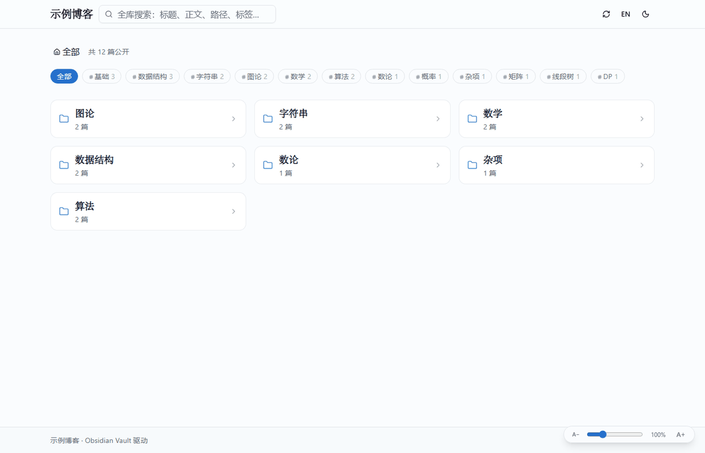
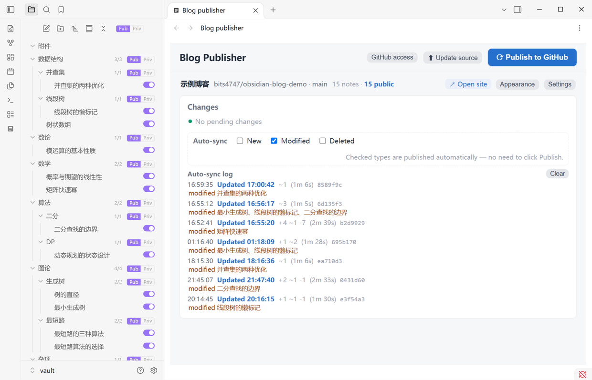
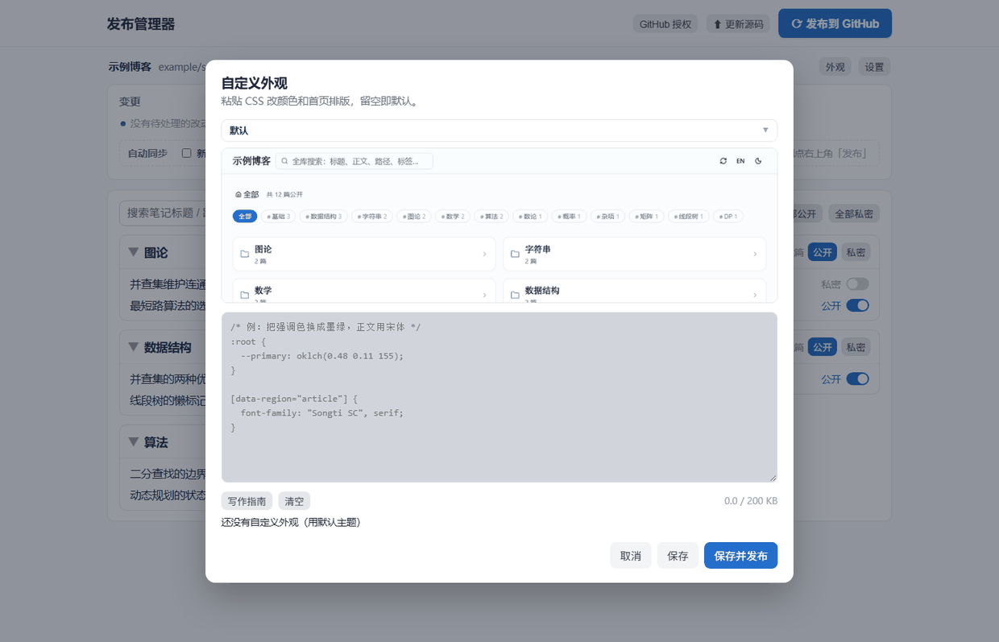
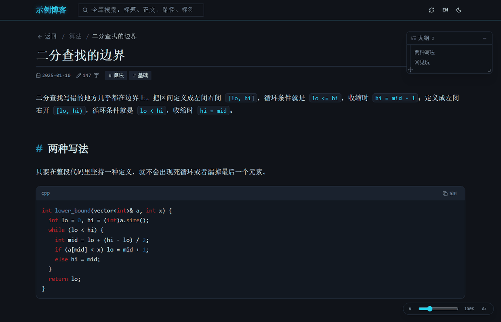

# Obsidian 博客

[English](README.en.md)

把 Obsidian 笔记发布成 GitHub Pages 静态博客。

不用为了发布另建一个库：私人笔记和公开笔记放在一起，公开与否只是 frontmatter 里的一个 `public: true`。发布器逐篇勾选、一键推送，站点由 GitHub Actions 自动构建部署。



## 优势一览

- **同一个库，公私有别**——`public: true` 的笔记才会被读取、才会进仓库；私密笔记不参与构建
- **公开开关长在文件树上**——每篇笔记右边一个小开关，文件夹标题栏有「全部公开 / 全部私密」，不用另开网页
- **复刻 Obsidian 的阅读体验**——双链、嵌入、callout、公式、标签、块引用、悬浮预览、可拖拽大纲
- **自定义外观**——粘贴一段 CSS 就能换配色与首页排版，内置六套预设（加「默认」共七项）带预览图，不用改代码
- **纯静态**——无数据库、无账号、无服务端，构建产物可以直接丢到任何静态托管
- **中英双语**——界面跟随 Obsidian 的语言设置，站点可随时切换

## 安装

不需要克隆仓库，也不用自己打包。到 [Releases](https://github.com/bits4747/obsidian-blog-publisher/releases/latest) 下载最新版的三个文件：

| 文件 | 说明 |
|---|---|
| `main.js` | 插件本体 |
| `worker.js` | 后台内核（发布、同步跑在子进程里，不占 Obsidian 主线程） |
| `manifest.json` | 插件清单 |

放进库的插件目录，目录名必须正好是 `blog-publisher`：

```
<你的库>/.obsidian/plugins/blog-publisher/
├── main.js
├── worker.js
└── manifest.json
```

然后在 Obsidian 设置 → 第三方插件里启用「博客发布器」（需要先关掉「安全模式」）。

### 前置条件

| 需要 | 为什么 |
|---|---|
| **Git**（[下载](https://git-scm.com)） | 发布、拉取都靠它，插件不自带 git |
| **Node.js** | 后台内核跑在子进程里。Obsidian 自带 Electron 时优先用它的 `utilityProcess`，拿不到时退回系统 `node`——两条路都走不通就会「插件装上了但点了没反应」 |
| GitHub 账号 | 站点托管在 GitHub Pages |

如果启用后点击没反应，先确认 `git --version` 和 `node -v` 在终端里都能正常输出。

### 手动更新

新版本发布后，把上面三个文件重新下载覆盖即可（Obsidian 重启后生效）。插件不会自动更新——它没上架社区插件商店。

## 第一次使用

### 1. 建连接

点右上角「设置」：本地库默认就是当前打开的这个库，填个博客名，再选「帮我新建一个仓库」，填仓库名点「在 GitHub 上创建」。

已经有仓库的话，切到「我已经有仓库了」粘贴地址即可。Pages 不必手动开——首次发布成功后会自动启用，已经开过的不会重复创建。

博客名同时是发布器里的显示名、网页标题和站点左上角的站名。

### 2. 授权

点「GitHub 授权」，按弹窗里的步骤生成 **Personal access token (classic)**，勾选这两个 scope：

| Scope | 用途 |
|---|---|
| `repo` | 推送内容、创建仓库 |
| `workflow` | 首次建站要把 `.github/workflows/deploy.yml` 推上去；GitHub 规定含 workflow 文件的推送必须带这个权限 |

> 只勾 `repo` 不够——推送会被 GitHub 拒绝，报错是 `refusing to allow a Personal Access Token to create or update workflow`。

有效期建议选「No expiration」。令牌过期后发布、建仓库、自动建站会一起失败，而报错信息看不出是过期。

**令牌怎么存的**：用系统自带的加密保存（Windows DPAPI / macOS Keychain），密文写在 `local.json` 里，只有你这个本机账号能解开，不进仓库、不上传。Linux 没有免依赖的等价物，退回明文并在下文说明。想撤掉授权，去 GitHub 的 Settings → Developer settings → Tokens 里删除该 token 即可。

### 3. 选笔记并发布

打开要公开的笔记的开关，点「⟳ 发布到 GitHub」。等 1~2 分钟，访问 `https://你的用户名.github.io/仓库名/`。

## 发布器界面

点左侧栏的图标，或命令面板里的「打开博客发布器」，主区域会开一个标签页。界面的语言与明暗跟随 Obsidian。



| 功能 | 说明 |
|---|---|
| 单库 | 一个 Obsidian 库对应一个博客。首屏只有一行信息条：库名 · 仓库 · 篇数 · 打开网页 · 设置 |
| 逐篇开关 | 每篇一个开关，写进 frontmatter，改完提示「已把《标题》设为公开」 |
| 批量操作 | 文件夹标题栏有「全部公开 / 全部私密」，顶部另有全局按钮 |
| 搜索筛选 | 按标题和路径过滤，先筛再批量 |
| 折叠 | 每个文件夹可收起，另有「一键展开 / 一键收起」 |
| 变更三栏 | 新增 / 修改 / 删除三类改动分三栏列出，新增的可以在这一栏直接开公开开关。只列**需要你手动处理**的：自动同步开关开着的类别由后台自己发，不进三栏；如果最近一次自动同步推送失败，那几类会重新回到三栏提醒 |
| 自动同步 | 三类改动各一个开关，勾选后该类改动自动发布，不必再点「发布」；默认「修改」开，「新增 / 删除」关。改了文件约 2.5 秒后自动提交推送，但**只在 Obsidian 开着时生效** |
| 同步流水 | 自动同步那一行下方列出最近几次后台动作：开始推送的时刻、动了哪些文件、推没推上去、成功更新的时刻、两者相隔多久。推送失败、构建失败、构建超时都各留一条记录。存本地配置，重启不丢 |
| 结果弹窗 | 每次「发布 / 更新源码 / 保存外观」都在右上角弹一张卡片，从转圈开始，最后定格成 ✓ 或 ✗，失败可展开日志。**没有关闭按钮，也不会自动消失，点卡片任意位置才收起** |
| 构建诊断 | 推送成功后不只看线上产物，还会查 GitHub Actions 这次的结论：卡住或失败会明确说「构建失败」「构建超时」，并可直接点开 Actions 页面 |
| 上线进度 | 手动发布后轮询线上 `data/index.json`，弹窗里显示「GitHub 正在构建部署…已等 N 秒」；部署完成变成「已上线（用时 N 秒）」并附打开链接；4 分钟仍未上线会提示去 Actions 查看 |
| 自定义外观 | 「外观」按钮打开 CSS 编辑框，内置七项预设（默认 + 六套）带预览图，可一键填入再改。详见下一节 |

## 自定义外观

站点的**功能**与**外观**是分开的：功能由源码里的 React 组件实现，外观集中在两处可覆盖的地方——CSS 变量（颜色、圆角、字体）和 `data-region` 选择器（首页与列表的排版）。所以不用改一行代码，写 CSS 就能换一套皮肤。

发布器右上角点「外观」，从下拉框里选一套预设（鼠标停在名字上能看简介，选中后下方显示这套的**预览图**），它会填进编辑框，再改成自己的。自己写的 CSS 无法预渲染，所以选「自定义」时不显示预览图。



### 内置预设

| 预设 | 首页排版 | 配色 |
|---|---|---|
| 默认 | 三列卡片 | 蓝白 |
| 墨绿 | 三列纸卡 | 暖纸底 + 松墨绿，全衬线 |
| 樱粉 | 单列大卡片，标题居中放大 | 极浅粉白 + 玫红 |
| 黑白 | 单列纯文字索引表 | 纯白纯黑，零圆角 |
| 树形 | 文件树，竖线导轨 + 拐角连接符 | 绿灰纸感 |
| 方格 | 大小方块拼贴，第一块占主位 | 六色循环 |
| 霓虹 | 编号目录行 | 近黑底 + 青/品红描边，等宽字体 |

### 写自己的 CSS

```css
/* 颜色：覆盖 :root 里的变量；深色模式在 .dark 下 */
:root {
  --primary: oklch(0.48 0.11 155);   /* 强调色：链接、按钮 */
  --background: oklch(0.99 0.004 250);
  --radius: 0.625rem;
}
.dark {
  --primary: oklch(0.72 0.155 252);
}

/* 首页与列表的排版：这几块有 data-region，可以改几列 / 卡片还是树状 */
[data-region="folders"] { display: grid !important; grid-template-columns: repeat(3, minmax(0,1fr)); }  /* 首页文件夹 */
[data-region="list"]    { }                      /* 笔记列表 */
[data-region="tags"]    { }                      /* 标签栏 */
[data-region="article"] { }                      /* 正文排版 */

/* 字体 */
body { font-family: "Songti SC", Georgia, serif; }
```

按钮旁边的「写作指南」会打开说明弹窗，里面列了可覆盖的变量、`data-region` 选择器和字号写法，还能一键把「颜色 / 圆角」那段插进编辑框。

三条要记住的：

- **宽度不归主题管**：顶栏、正文、页脚、首页统一读 `--content-w`（默认 `78rem`），每套预设都不写 `max-width`。想整体加宽或收窄就改这一个值，所有页面一起变。
- **字号要写 `var(--fsu)`**：`--fsu` 是「跟随阅读字号的 1rem」。根字号是故意不动的（否则一放大字号，栏宽和控件跟着变形），所以主题里的字号写成 `calc(1.1 * var(--fsu))` 才会跟着滑块走。
- **清空 = 恢复默认**：框里留空保存会删掉 `theme.css`，回到默认主题。

保存写进仓库工作副本的 `public/theme.css`，还没上线；「保存并发布」只提交推送这一个文件，不会带上你还没准备好的笔记。上限 200 KB；全是注释等于没写，按「无自定义外观」处理。保存后 1~2 分钟生效，URL 带内容哈希绕开 GitHub Pages 的缓存。

### 为什么只给 CSS，不给整页模板

站点是 Next 静态导出，页面结构在 React 里编译好了。让用户改 HTML 等于把模板引擎暴露出去，安全与升级成本都不是这个项目该承担的。CSS 足以改颜色、字体、间距、显隐、位置（flex/grid 都能覆盖），而且样式表永远没法被执行成 HTML/JS——`theme.css` 是以 `<link>` 外链引入的，不是内联 `<style>`，一个 `</style>` 也逃不出去。

和博客园那种「整套皮肤代码（HTML + CSS + JS）」相比：自由度更低，但站点升级时皮肤不会失效，也不会被注入脚本。代价是改不了 DOM 结构（比如加一个新栏目）。

## 博客站点

阅读体验以复刻 Obsidian 的呈现为目标。



### 首页

- 顶部显示 `共 N 篇公开`
- **逐层下钻 + 面包屑**：首页只列当前层的子文件夹（卡片）和该层直属笔记，点文件夹进入下一层，面包屑 `全部 › 父 › 当前` 可点回任意一层，文件夹可套任意多层
- 当前层用 `?folder=` 深链，刷新、分享、前进后退都回到同一层；笔记页也带来源，点「返回」回到进来时那一层
- 标签栏筛选，显示 `标签筛选：（N 篇）`
- 搜索匹配标题、正文、路径、标签四个字段，可与标签筛选叠加；命中正文的结果带一行上下文片段，点开后自动滚到那句话并高亮
- 更新及时性：索引按分钟级 URL 取，即使 HTML 被 Pages 缓存 10 分钟也能在 1 分钟内看到新内容

### 笔记页

- `N 字` 字数、发布日期、标签
- 右侧可拖拽悬浮大纲，当前章节高亮，可拖动、可调宽
- 字号缩放 80%~160%（右下角滑杆）：**只缩放文字**，不动版面——栏宽、卡片尺寸、控件大小全都不变
- 全站统一内容宽度 `--content-w`（默认 `78rem`），顶栏、正文、页脚、首页共用

### 支持的 Obsidian 语法

| 语法 | 效果 |
|---|---|
| `[[笔记]]` | 可点击跳转，悬停弹出预览浮窗 |
| 出链 / 反链 | 文末列出「链接到本文的笔记」与「本文的出链」 |
| 未创建 / 未公开 | 出链里区分这两种目标，指向私密笔记的会显示锁 |
| `![[附件]]` | 图片等附件正常显示 |
| `[!note]` 等 | 13 种 callout 类型 |
| `==高亮==` | 高亮 |
| `#标签` | 可点击筛选。纯数字（`#2427` 这类题目编号）与 3~8 位十六进制（`#ff0000` 这类颜色值）不算标签；链接文字里的 `#xxx` 也不解析 |
| `^块引用` | 定位到具体段落，目标不存在时回退为全文 |
| `$公式$` | KaTeX 渲染，大纲里的公式同样渲染 |

站点支持中英切换与明暗主题，阅读偏好（字号、折叠、筛选）本地记住。

## 插件做了哪些事

- 左侧文件树里，每篇笔记右边一个小开关（24×13），点一下就能改公开状态——写的就是 frontmatter 里的 `public` 字段
- 每个文件夹标题右边有 `已公开数/总数` 和「公开」「私密」两个按钮，点哪个就是整夹变成哪个状态。用两个按钮而不是一个开关，是因为开关只有一个方向，一个部分公开的文件夹点下去只能被推断成「全公开」
- 文件树顶部工具条有同样的按钮，管全库，点下去会先弹一次确认
- 三种状态：全公开、全私密、部分公开（两个都不点亮，配合行尾的 `3/6` 计数一眼看出是混合状态）
- 主区域开的「博客发布器」标签页里是完整的发布界面，功能与上一节列的一致

## 常见问题

**发布后网站没变？**
GitHub Actions 要跑 1~2 分钟。发布器的结果弹窗会显示「正在构建部署…已等 N 秒」，完成后变成「已上线（用时 N 秒）」。超过 4 分钟还没上线，弹窗会提示去仓库的 Actions 页面看构建日志。

**`site-template/` 是干什么的？能删吗？**
首次启用时插件会把站点源码模板（42 个文件，约 408 KB）铺到数据目录的 `site-template/`，之后「更新源码」用它推送站点代码。不用手动删——模板带内容指纹，升级插件后会自动重铺。

**文件树上的开关点了没反应？**
开关只在**当前库就是发布器配置的那个库**时生效。库对不上会提示一次并停用，因为发布器一次只服务一个库。

**界面语言和明暗能单独设吗？**
不能，跟随 Obsidian：简体/繁体中文都算中文，其它语言算英文；明暗也跟着 Obsidian 的主题走。

**公开状态存在哪？换电脑还在吗？**
写进每篇笔记 frontmatter 里的 `public` 字段，所以公开状态跟着笔记走——换了库、换了电脑，打开还是原来的状态。

**发布失败，说是推送失败？**
先看弹窗里展开的日志。最常见的是令牌过期——症状是发布、建仓库、自动建站一起失败，报错信息看不出原因。重新生成一个 token 再粘进去即可。

**私密笔记会被读取或上传吗？**
不会。构建时只读 `public: true` 的笔记，以及它们引用的附件。私密笔记的正文、标题、路径都不会出现在仓库里。

**能改页面结构吗？比如加一个栏目。**
不能。外观只开放 CSS（见上文「为什么只给 CSS」）。加栏目属于功能改动，要改 React 源码。

**想用自己的域名。**
在 GitHub 仓库的 Settings → Pages 里填 Custom domain，再把 DNS 指过去。这一步在 GitHub 上做，发布器不涉及。

**安装插件时报「无法加载」？**
先确认 `main.js`、`worker.js`、`manifest.json` 三个文件都在 `<库>/.obsidian/plugins/blog-publisher/` 里，目录名不要改。再确认本机装了 Git（发布要推送），Obsidian 处于「第三方插件」已开启的状态。

**能在本地先看看站点效果吗？**
`npm run build` 之后 `npm run preview`，打开 `http://localhost:8080`。这需要源码仓库，不是插件使用者的必需步骤。

**可以跑多个博客吗？**
可以。一个 Obsidian 库对应一个博客，在库里配一条连接即可。换库就是换博客，发布器会按当前打开的库自动对上它的连接——插件里没有「切换」按钮，因为 Obsidian 一次只开一个库。

**自动同步在关掉发布器后还会跑吗？**
不会，这是有意的：自动推 git 不该在没人看着的时候跑。

## 数据存放位置

源码目录只放程序代码。个人数据（连接、令牌、笔记镜像、构建产物）都在系统用户目录：

| 系统 | 路径 |
|---|---|
| Windows | `%APPDATA%\obsidian-blog` |
| macOS | `~/Library/Application Support/obsidian-blog` |
| Linux | `~/.config/obsidian-blog` |

内含 `connections.json`（博客连接清单）、`local.json`（GitHub 令牌、各连接的本地库路径）、`repos/<连接id>/`（仓库工作副本）、`content/`（公开笔记镜像）、`build/`（构建产物）。

`local.json` 里的 GitHub 令牌用**系统加密**保存：Windows 走 DPAPI（CryptProtectData，作用域 CurrentUser），macOS 走 Keychain，密文存在 `local.json` 的 `githubTokenEnc` 字段里，只有你这个本机账号能解开。Linux 没有免依赖的等价物，会退回明文的 `githubToken` 字段——在那种环境下，任何能读你用户目录的程序都能拿到它。想彻底撤掉授权，去 GitHub 删掉该 token。

想改到别处（U 盘、同步盘）：设环境变量 `OBSIDIAN_BLOG_DATA` 后重启 Obsidian。

## 工作原理

```
你的 Obsidian 库（私人笔记 + 公开笔记混放）
   │  ① 只读取 public: true 的笔记及其引用的附件
   ▼
博客发布器（Obsidian 里的插件，后台子进程跑同一套内核）
   │  ② git add / commit / push
   ▼
GitHub 内容仓库（Markdown 原文）
   │  ③ GitHub Actions 跑 npm run build
   ▼
GitHub Pages
```

仓库里只存 Markdown 原文，diff 就是笔记的改动，可读可回滚。代价是发布后要等 CI 跑完。

## 本地开发

这套代码同时是站点源码和一个 Obsidian 插件。改站点样式、Markdown 管线或发布逻辑，都在这个仓库里做。

插件是独立的 npm 包（`obsidian`、`esbuild` 只它用），所以装完根目录还要装一次它的依赖，否则 `npm run typecheck` / `npm run plugin` 会报找不到 `obsidian`：

```bash
npm ci
npm --prefix obsidian-plugin ci
```

之后：

```bash
npm run dev        # 开发服务器 → http://localhost:3010
npm run build      # 完整构建（生成内容 + 静态导出 + 搬运产物）
npm run preview    # 预览构建产物 → http://localhost:8080
npm run typecheck  # 站点与插件的类型检查
npm run plugin     # 打包 Obsidian 插件（main.js / worker.js）
npm run presets    # 从 themes/*.css 重新生成内置预设
npm test           # 端到端回归测试
```

调试发布逻辑时可以在浏览器里开同一个界面，比反复重载插件快：

```bash
npm run dev:manager   # → http://localhost:3457
```

它跑的是插件用的同一份内核（`scripts/manager-core.mjs`），只把界面换成浏览器打开，方便看请求与日志。`npm test` 也是靠它起实例的。**它不是给使用者准备的使用方式**——插件形态下界面就在 Obsidian 里，不需要另挂进程。

`npm run dev` 需要内容已生成——全新克隆先跑一次 `npm run build`，或用发布器连一个库。

### 改内置预设

预设的 CSS 源文件在 `themes/`，**不要直接改 `scripts/theme-presets.mjs`**（它是生成物）。改完 `themes/*.css` 后跑 `npm run presets` 重新生成；预设的中英文名与简介写在 `scripts/gen-theme-presets.mjs` 的 `META` 里。

预览图是「用示例笔记构建一遍站点 → 逐套注入 CSS 截图 → 压成 base64 模块」四步产物，链路在 `tools/preview/`：

```bash
node tools/preview/make-preview-content.mjs      # 1. 造示例笔记（站名「示例博客」）
npm run build                                    # 2. 构建
node tools/preview/gen-theme-previews.mjs _preview/site _preview/shots   # 3. 无头 Chrome 截图
python tools/preview/pack-theme-previews.py      # 4. 压成 scripts/theme-previews.mjs
```

第 3 步需要本机装了 Chrome（不在默认路径时用 `CHROME` 环境变量指定），第 4 步需要 Python 的 Pillow。示例内容是刻意造的假笔记：预览图会打包进插件随源码分发，不能出现任何真实笔记。

`npm test`（即 `bash scripts/e2e-run.sh`）用独立的临时数据目录起一个服务实例跑完整回归，不会碰你已有的连接、令牌与本地库。**不要直接跑 `node scripts/e2e-test.mjs`**：它会建/删连接，没有临时数据目录时会把测试连接写进你真实的配置目录（脚本现在会直接拒绝运行并提示改用上面的命令）。

部署到自己的服务器：`npm run build` 后，把用户数据目录下 `build/site/` 的内容拷到任意静态服务器。

## 项目结构

```
obsidian-blog-publisher/
├── README.md / README.en.md     中文 / 英文说明
├── CHANGELOG.md / .en.md        版本变更
├── CONTRIBUTING.md / .en.md     贡献指南
├── LICENSE / .editorconfig / .gitattributes / .gitignore
├── package.json                 依赖与脚本入口
├── next.config.ts               Next 配置（output: 'export'，支持 basePath）
├── .github/
│   ├── workflows/verify.yml     类型检查 + e2e（推代码时跑）
│   ├── workflows/deploy.yml     构建并部署到 Pages（站点仓库里跑）
│   └── ISSUE_TEMPLATE/          issue 模板
├── docs/screenshots/            README 用的截图
│
├── scripts/
│   ├── manager-core.mjs         ★ 发布内核（HTTP 服务 + 全部接口，插件与本地调试共用）
│   ├── ui-template.mjs          ★ 界面 HTML/CSS/JS（插件与本地调试共用同一份）
│   ├── manager.mjs              本地调试入口：在 Obsidian 外起内核（e2e 也用它）
│   ├── build-content.mjs        ★ 内容编译器（Markdown → JSON）+ 产物搬运
│   ├── theme-presets.mjs        内置外观预设（由 themes/*.css 生成）
│   ├── theme-previews.mjs       预设预览图（base64 PNG）
│   ├── serve.mjs                本地静态预览服务器
│   ├── e2e-test.mjs             端到端回归测试
│   └── e2e-run.sh               测试一键运行（独立临时数据目录）
│
├── themes/                      六套外观预设的 CSS 源文件
├── tools/preview/               预览图生成链路（示例内容 → 截图 → 打包）
│
├── obsidian-plugin/             Obsidian 插件（复用上面的内核与界面）
│   ├── manifest.json / versions.json / package.json / esbuild.config.mjs
│   ├── main.js / worker.js      构建产物（Release 里上传的就是这两个）
│   └── src/
│       ├── main.ts              插件入口：utilityProcess 起内核、开视图
│       ├── worker-entry.ts      内核跑在子进程里（git 是同步调用，不能占主线程）
│       ├── explorer.ts          原生文件树上的公开控件
│       └── template.ts          首次运行把站点源码模板铺到数据目录
│
└── src/
    ├── app/                     根布局、入口页、全局样式（明暗主题变量）
    ├── components/blog/         ★ 应用外壳 / 首页 / 详情页 / 悬浮预览 / Markdown 管线
    ├── components/ui/           shadcn/ui 基础组件
    └── lib/
        ├── wikilink.mjs         ★ Obsidian 语法解析的唯一实现（构建期与渲染期共用）
        ├── obsidian.ts          ★ 数据模型：标题提取、公式切分、路径映射
        ├── remark-obsidian.ts   ★ remark 插件：wikilink / 嵌入 / callout / 高亮 / 标签
        ├── rehype-safety.ts     安全净化：挡危险链接与内联脚本
        ├── api.ts / store.ts    站点取数与视图状态
        └── i18n.ts / site.ts    中英文字典、站名与 basePath 解析
```

★ = 核心文件

## 技术栈

| 层 | 选型 | 理由 |
|---|---|---|
| 框架 | Next.js 16（App Router，静态导出） | 组件化写 UI，同时能导出成纯静态文件 |
| UI | React 19 + Tailwind CSS v4 + shadcn/ui | 无运行时样式引擎，产物小 |
| Markdown | react-markdown + remark/rehype 插件链 | 标准 AST 管线，Obsidian 语法以插件接入 |
| 公式 | KaTeX | 能同步渲染，大纲也要用 |
| 状态 | zustand + persist | 阅读偏好持久化，无账号体系 |
| 发布界面 | 原生 JS（内嵌在 ui-template.mjs） | 本地工具，不值得再引一套构建链 |
| 部署 | GitHub Actions + Pages | 免费，无需服务器 |

渲染管线：`remark-gfm`（表格 / 任务列表 / 删除线）→ `remark-math`（公式）→ **`remark-obsidian`**（双链 / 嵌入 / callout / 高亮 / 标签）→ `rehype-raw` → **`rehype-safety`**（安全净化）→ `rehype-highlight`（代码高亮）→ `rehype-katex`（公式渲染）。加粗的两个是本项目插件。

## 许可

[MIT](LICENSE) © 2026 bits47

可自由使用、修改、商用、再发布，唯一要求是保留版权声明。软件按「原样」提供，不承担担保责任。

MIT 只覆盖本项目的代码——你用这个工具生成的博客站点与笔记内容，版权归你所有。

## 致谢

构建于 Next.js、React、Tailwind CSS、KaTeX、remark/rehype 生态之上。
